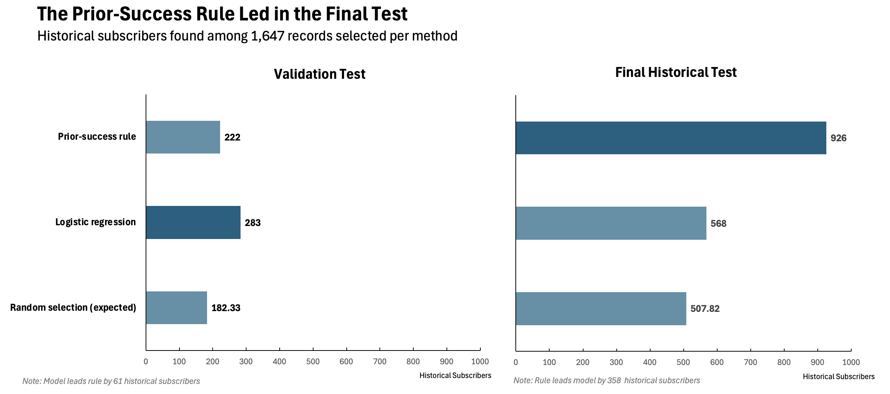

# Which Customers Should a Bank Call First?

Edward O. Henderson | ClearPath Data Solutions LLC

**Portfolio project: simulated client engagement using public historical data.**

## Business question

Can a ranking based on information assumed available before outreach identify more historical term-deposit subscribers than random selection and a simple prior-campaign-success rule, at the same selection volume?

The historical analysis informs whether to consider a controlled live pilot. It does not establish the effect on new deposits or performance per call attempt.

## Main finding

The logistic ranking led in validation, but the prior-success rule led on the reserved final records. I recommended deferring a pilot of the logistic ranking. A pilot of the simpler rule remains conditional on operational checks and an agreed business success target.

| Method | Validation subscribers | Final historical subscribers |
| --- | ---: | ---: |
| Logistic regression | 283 | 568 |
| Prior-success rule | 222 | 926 |
| Random selection (expected) | 182.33 | 507.82 |

Each method selected **1,647 records from the same 8,238-record block**. Methods can select overlapping records. Random selection is an analytical expectation, so its count can be fractional.

The model led the prior-success rule by 61 subscribers in validation and trailed it by 358 in the final block. The provisional simulated decision target required at least 33 more subscribers than **each** benchmark. This planning target is not a statistical significance test or a bank-validated economic threshold.

Prior-success records increased from 162 in validation to 1,205 in the final block. Overall subscription rates also changed from 11.07% to 30.83%; raw counts across blocks reflect different historical populations.

## Read the case study

- [Portfolio case study](docs/case_study.md)
- [Word draft v0.2](docs/Bank_Marketing_Portfolio_Case_Study_v0.2.docx)
- [Full-size chart](assets/benchmark_comparison.png)
- [Detailed reproduction instructions](REPRODUCING.md)
- [Results and metric definitions](results/README.md)

## Analytical design

The analysis preserves the source order in UCI's `bank-additional-full.csv`:

| Block | Source row IDs, excluding header | Records | Subscribers | Purpose |
| --- | --- | ---: | ---: | --- |
| Development | 1–24,712 | 24,712 | 1,188 | Fit preprocessing and logistic regression |
| Validation | 24,713–32,950 | 8,238 | 912 | Compare the candidate with benchmarks |
| Reserved final evaluation | 32,951–41,188 | 8,238 | 2,540 | Evaluate the frozen candidate and rules |

Nine candidate pre-outreach fields are used: `age`, `job`, `marital`, `education`, `default`, `housing`, `loan`, `previous`, and `poutcome`. Numeric fields are standardized, categorical fields are one-hot encoded, and unknown categories are retained. Call duration and current-campaign contact count are excluded. Other timing-dependent fields are held out.

The final model is fitted on development records only; validation records are not added to training. Selection and tie-breaking rules are fixed before the final method comparison. Intake checks include final-block counts; the final block is reserved for the method comparison, rather than being completely unseen during intake.

## Benchmarks

- **Random selection:** expected subscribers = selections × block subscribers ÷ block records.
- **Prior-success rule:** select records whose `poutcome` is `success`, then fill remaining places randomly from other records without replacement, using seed 42. Both evaluated blocks contain fewer than 1,647 prior successes, so all prior successes fit.

## Recommendation and limitations

The dataset includes contacted customers and historical outcomes. It lacks the original call-list order, the full eligible customer pool, complete attempt logs, full dates, and customer identifiers. Source order supports an earlier-to-later evaluation, but repeat customers may cross blocks. Prior outcomes must be verified as available before preparing a real call list.

Before considering a live pilot, verify eligibility and prior outcomes, document the current calling process, confirm equal attempt budgets and follow-up rules, and agree with Finance on the improvement needed. Randomly assign customers to current practice or the prior-success approach, and measure new term deposits per 100 outbound attempts, including follow-ups.

No live pilot or real client engagement was conducted.

## Data and tools

- Source: [UCI Machine Learning Repository — Bank Marketing](https://archive.ics.uci.edu/dataset/222/bank+marketing), using `bank-additional-full.csv` (41,188 records; semicolon-delimited).
- Python, scikit-learn, NumPy, and SciPy for analysis; Excel for the chart; Word for the case study.
- The original source data must be obtained separately. Internal proposal, billing, and simulated client notes are outside this portfolio package.
