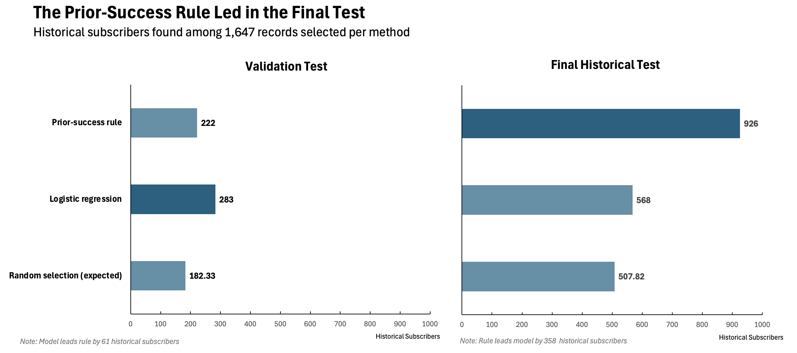

# Which Customers Should a Bank Call First

Edward O. Henderson  |  ClearPath Data Solutions LLC

Portfolio case study draft v0.2  |  Simulated engagement using public data

A bank with limited calling capacity needs to decide who goes first on its term-deposit outreach list. I tested whether a logistic regression ranking could find more historical subscribers than two benchmarks at the same selection limit. The model led in validation. On the reserved historical test, the rule based on prior campaign success found 926 subscribers, compared with 568 for the model. That result led me to recommend deferring a pilot of the model.

Figure 1. The logistic ranking led the prior-success rule by 61 subscribers in validation. On the reserved records, the rule led by 358. Random selection is shown as an expected count. The overall subscription rate was 11.07% in validation and 30.83% in the final block.

## How I set up the comparison

I used the 41,188 date-ordered records in UCI’s bank-additional-full.csv. I trained the logistic regression on the earliest 24,712 records using nine candidate pre-outreach fields. I excluded call duration and current campaign contact count. I used the next 8,238 records to decide whether to advance the model and reserved the last 8,238 for the final comparison after fixing the model and selection rules.

Each method received 1,647 selections per block, approximately 20%. Logistic regression selected the highest scores. The prior-success rule selected all records with a successful previous campaign and filled the remaining slots by seeded random sampling without replacement. The random benchmark used the expected number of subscribers in a uniform draw of the same size.

## Why the Recommendation Changed

Logistic regression found 283 historical subscribers in validation, compared with 222 for the prior-success rule and 182.33 expected under random selection. That result supported advancing the model to the reserved final test.

On the final records, the prior-success rule found 926 subscribers, compared with 568 for logistic regression and 507.82 expected under random selection. Each method had the same 1,647-record selection limit. Prior-success records increased from 162 in validation to 1,205 in the final block, giving the simple rule a much larger group to prioritize.

For this simulated engagement, we chose a provisional target of finding at least 33 more historical subscribers than each benchmark. The model found 358 fewer subscribers than the prior-success rule, so ClearPath recommended deferring a pilot of the logistic ranking.

## What the data can tell us

The records cover customers the bank contacted. The export lacks the original call lists, the full eligible pool, and complete attempt logs. The historical comparison measures how many past subscribers each method found under the same selection limit. The effect on deposits per call attempt under the bank’s current process remains unknown.

The file is ordered by date, but it lacks full dates and customer identifiers. The split follows source row order, and repeat customers may appear across blocks. The prior-success rule also depends on the bank being able to verify prior outcomes before list preparation.

## What a controlled pilot would measure

If Operations verifies the current eligible pool and prior outcomes and confirms the call-attempt budget per group, the bank could test the prior-success rule against its current calling process. Randomly assign eligible customers to the two approaches and apply the same offer, attempt budget, follow-up rules, and measurement window. The outcome would be new term deposits opened per 100 outbound call attempts, including follow-ups. Finance would confirm what improvement would justify a change before launch.

## Data source

UCI Machine Learning Repository. Bank Marketing. Analysis uses bank-additional-full.csv. [View the dataset](https://archive.ics.uci.edu/dataset/222/bank+marketing).
